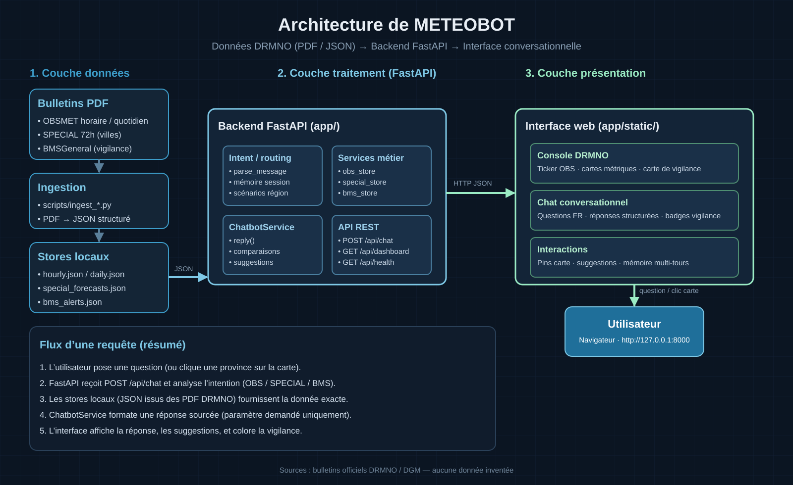

# METEOBOT — Chatbot météorologique

Assistant conversationnel qui répond en langage naturel à partir des bulletins officiels de la
Direction Générale de la Météorologie du Maroc : observations, prévisions à 72 h et vigilance.
Chaque réponse cite sa source ; quand une donnée manque, le bot le dit au lieu d'inventer une valeur.

Projet de fin d'année (PFA), Direction Régionale de la Météorologie du Nord-Ouest (Rabat),
juin – juillet 2026. Réalisé par **El Hendi Mohamed Mehdi**.



## Ce que fait le bot

| Famille de bulletins | Question type | Données traitées pendant le stage |
| --- | --- | --- |
| Observations (OBSMET) | « Quelle était la température à Rabat le 10 juin à 17 h ? » | 24 bulletins horaires, 18 stations |
| Prévisions spéciales 72 h | « Quelle est la prévision pour Larache demain ? » | 37 prévisions, 13 villes |
| Vigilance (BMS / BAM) | « Y a-t-il une alerte pour Ouezzane ? » | 3 bulletins nationaux |

Autres fonctions : comparaison entre deux villes, relances en contexte (« et demain ? »,
« et à Tanger ? »), questions de clarification quand la demande est ambiguë, carte de vigilance du Maroc.

## Fonctionnement

1. **Ingestion** : des scripts Python (`scripts/ingest_*.py`, pdfplumber) extraient les bulletins PDF
   et les structurent en JSON dans `data/obs/`.
2. **Compréhension** : le service détecte l'intention (observation, prévision, alerte) et extrait
   la ville, la période et la mesure demandées, à l'aide de règles.
3. **Réponse** : le bot cherche dans les données indexées et renvoie une réponse structurée
   avec sa source, ou un message clair si l'information n'existe pas.

## Stack

Python · FastAPI · Pydantic · pdfplumber · pytest · interface web HTML/CSS/JavaScript

## Lancer le projet

```bash
python -m venv .venv
# Windows : .venv\Scripts\activate    macOS / Linux : source .venv/bin/activate
pip install -r requirements.txt
cp .env.example .env        # Windows : copy .env.example .env
uvicorn app.main:app --reload --port 8000
```

Ouvrir http://127.0.0.1:8000. L'API principale est `POST /api/chat`.

Les données indexées des bulletins (`data/obs/` : observations horaires et quotidiennes, prévisions spéciales, vigilance)
sont incluses : le bot fonctionne dès l'installation. Elles sont publiées **avec l'autorisation de la Direction
Régionale de la Météorologie du Nord-Ouest (DGM)**, source des bulletins. Pour indexer de nouveaux bulletins PDF,
placez-les dans `sources/` puis lancez les scripts `scripts/ingest_*.py`.

## Tests

```bash
pip install pytest
pytest
```

35 tests couvrent la détection d'intention, les bulletins de vigilance et de prévision,
les observations quotidiennes, la comparaison entre villes et le filtrage par mesure.
La plupart s'appuient sur les bulletins indexés dans `data/obs/`.

## Structure

```
app/        API FastAPI, services (intention, chatbot, stores de données), interface web
data/       bulletins indexés (data/obs/) et fond de carte du Maroc
scripts/    ingestion des PDF et génération de figures
tests/      tests automatisés
docs/       schéma d'architecture
```
